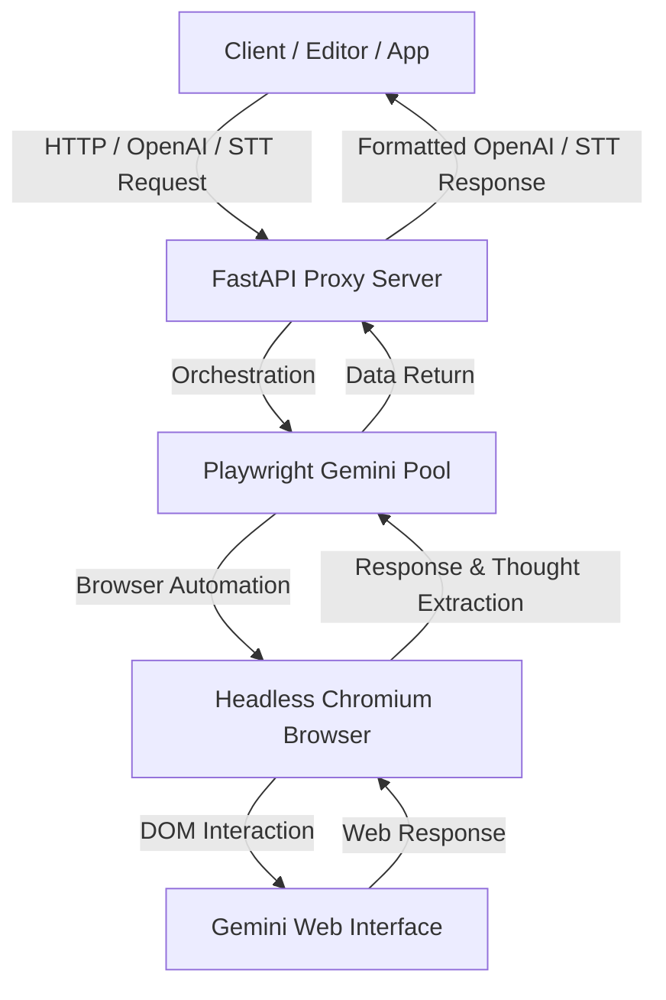

# Gemini API & Proxy Server

<p align="center">
    
</p>

This project is a **high-performance local proxy server and wrapper** that makes Google Gemini's intelligence available for free to any third-party client or application. By emulating industry-standard communication protocols, it acts as a bridge between your code editors (like Cursor and VS Code), virtual assistants, or AI tools, and the official Gemini web interface.

Completely written in **Python** and built on top of **Playwright** automation, this server allows you to use the most up-to-date Gemini model with support for Vision (images), Extended Thinking, and Speech-to-Text without paying for official API tokens.

---

## 🔍 How the Project Works Under the Hood

The secret of this project lies in its ability to automate and interact with the [Google Gemini Web](https://gemini.google.com/) site in the same way a human would, but programmatically, quickly, and invisibly.



### 1. The Engine: Python + Playwright
* **Browser Initialization**: When the proxy server starts, Python (via FastAPI) initializes the `PlaywrightGeminiPool`. This pool opens and manages optimized Chromium browser instances in the background (headless mode by default).
* **DOM (Document Object Model) Automation**: Playwright locates specific selectors on the Gemini chat page to:
  1. Inject the user's message or prompt into the input field (`textarea`).
  2. Attach media files and base64-converted images.
  3. Click the send button safely through the page execution context (`page.evaluate`).
  4. Wait for processing in real-time (including support for token streaming).
* **Intelligent Content Extraction**: As soon as the response starts generating, custom CSS selectors scan the page to capture the produced content. The wrapper separately extracts the **clean response text**, the **thoughts/reasoning (Extended Thinking)**, and generated metadata, filtering out any visual residue from the web panel.

### 2. The Wrapper and Proxy (FastAPI)
The wrapper exposes HTTP routes identical to those of the official OpenAI and Google APIs:
* **Compatibility with OpenAI Chat Completions** (`/v1beta/openai/chat/completions`): Translates JSON payloads containing chat history (`messages`), system guidelines (`system_instruction`), and media files into commands that Playwright executes on the Gemini web page. It then formats the return as a standard OpenAI-compatible response.
* **Compatibility with Google Speech-to-Text (STT)** (`/v1/speech:recognize`): Receives raw audio in PCM format (LINEAR16), converts it internally to WAV using Python, and sends it to Gemini in multimodal format to obtain a fast and perfect transcription of the received audio.

### 3. Multi-Profile Management
To prevent your account from being blocked due to excessive requests and to allow the use of different Google accounts on the same server, the project features a robust multi-profile system.

* **Storage Structure**: Each configured account has its own directory under `profiles/`:
  ```text
  profiles/
  ├── personal_account/
  │   └── cookies.json     # Account-specific session cookies
  ├── work_account/
  │   └── cookies.json
  └── cookies/
      └── cookies.json     # Default profile
  ```
* **Session Cookies**: The `cookies.json` files store essential Google authentication tokens (`__Secure-1PSID` and `__Secure-1PSIDTS`).
* **How to Sync New Profiles**:
  The `sync_cookies.py` script allows you to create and update profiles in a fully visual way:
  ```bash
  python sync_cookies.py <profile_name> --login
  ```
  This will open a browser window. Simply log in to the desired Google account, navigate to Gemini, and close the browser. The script will extract and save valid cookies in the corresponding profile folder.
* **Profile Persistence**: The local `.selected_profile` file stores which profile is currently active, ensuring that the server uses the correct account upon each startup.

---

## 🛠️ Quick Installation and Setup

### Prerequisites
* **Python 3.10 or higher** installed on your system.
* An active Google account.

### Installation (Windows)
Just run the automated script in the project root:
```cmd
setup_and_run.bat
```
This script creates the virtual environment (venv), installs all Python and Playwright dependencies, and starts the interactive menu.

### Manual Installation (Any OS)
1. Create and activate a Python virtual environment:
   ```bash
   python -m venv venv
   source venv/bin/activate  # On Windows use: venv\Scripts\activate
   ```
2. Install the package in editable mode and install dependencies:
   ```bash
   pip install -e .
   pip install fastapi uvicorn playwright pillow
   python -m playwright install chromium
   ```

3. Configure the login profile (Replace `<profile_name>` with your preferred name):
   ```bash
   python sync_cookies.py <profile_name> --login
   ```
   *Log in to the browser window that opens, navigate to Gemini, and then close the window.*

4. Select the active profile:
   ```bash
   # The system will use the profile saved in .selected_profile
   echo <profile_name> > .selected_profile
   ```

---

## 🚀 Running the Proxy Server

To start the server locally:
```bash
python proxy_server.py
```
The FastAPI server will start and listen on the local port: `http://localhost:8000`.

### Cursor / VS Code / AI Apps Integration
Configure your AI client or code editor as follows:

* **API URL / Base URL**: `http://localhost:8000/v1beta/openai`
* **API Key**: Any value (e.g., `sk-generic-key`)
* **Model**: Any name (the proxy will automatically map it to the active model selected on the server).

---

## ⚖️ License

This project is distributed under the MIT License. See the `LICENSE` file for details.
