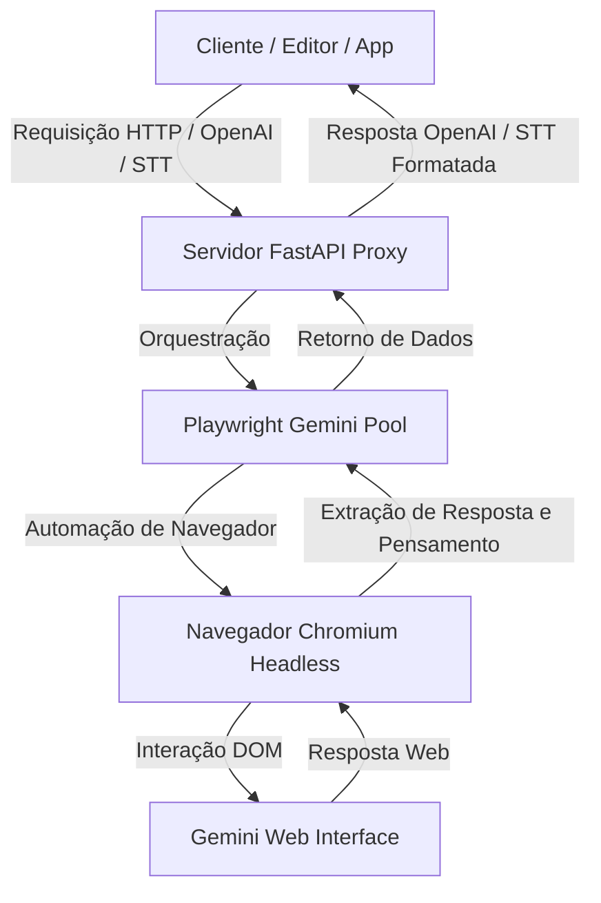

# Gemini API & Proxy Server (Original)

<p align="center">
    
</p>

Este projeto é um **wrapper e servidor proxy local de alta performance** que disponibiliza a inteligência do Google Gemini de forma gratuita para qualquer cliente ou aplicação de terceiros. Ao emular protocolos de comunicação da indústria, ele atua como uma ponte entre seus editores de código (como Cursor e VS Code), assistentes virtuais ou ferramentas de IA, e a interface web oficial do Gemini.

Totalmente escrito em **Python** e construído sobre a automação do **Playwright**, este servidor permite que você use o modelo mais atualizado do Gemini com suporte a Visão (imagens), pensamento estendido (Extended Thinking) e reconhecimento de voz (Speech-to-Text) sem precisar pagar por tokens de API oficial.

---

## 🔍 Como o Projeto Funciona por Baixo dos Panos

O segredo deste projeto reside na capacidade de automatizar e interagir com o site do [Google Gemini Web](https://gemini.google.com/) da mesma forma que um humano faria, porém de forma programática, rápida e invisível.



### 1. O Motor: Python + Playwright
* **Inicialização do Browser**: Quando o servidor proxy é iniciado, o Python (via FastAPI) inicializa o `PlaywrightGeminiPool`. Este pool abre e gerencia instâncias otimizadas do navegador Chromium em segundo plano (modo *headless* por padrão).
* **Automação do DOM (Document Object Model)**: O Playwright localiza os seletores específicos do chat do Gemini para:
  1. Injetar a mensagem ou prompt do usuário no campo de entrada (`textarea`).
  2. Anexar arquivos de mídia e imagens convertidas para base64.
  3. Clicar no botão de envio de forma segura através do contexto de execução da página (`page.evaluate`).
  4. Aguardar o processamento em tempo real (incluindo o suporte a streaming de tokens).
* **Extração Inteligente de Conteúdo**: Assim que a resposta começa a ser gerada, seletores CSS customizados escaneiam a página para capturar o conteúdo produzido. O wrapper extrai separadamente o **texto limpo da resposta**, os **pensamentos/raciocínio (Extended Thinking)** e os metadados gerados, filtrando quaisquer resíduos visuais do painel web.

### 2. O Wrapper e Proxy (FastAPI)
O wrapper expõe rotas HTTP idênticas às das APIs oficiais da OpenAI e do Google:
* **Compatibilidade com OpenAI Chat Completions** (`/v1beta/openai/chat/completions`): Traduz payloads JSON contendo histórico de chat (`messages`), diretrizes de sistema (`system_instruction`) e arquivos de mídia em comandos que o Playwright executa na página web do Gemini. Em seguida, formata o retorno como uma resposta padrão compatível com OpenAI.
* **Compatibilidade com Google Speech-to-Text (STT)** (`/v1/speech:recognize`): Recebe áudio cru no formato PCM (LINEAR16), converte-o internamente para WAV usando Python e o envia ao Gemini em formato multimodal para obter a transcrição perfeita e veloz do áudio recebido.

### 3. Gerenciamento de Múltiplos Perfis (Multi-Profile)
Para evitar que sua conta seja bloqueada por excesso de requisições e para permitir o uso de diferentes contas Google no mesmo servidor, o projeto conta com um sistema robusto de múltiplos perfis.

* **Estrutura de Armazenamento**: Cada conta configurada possui seu próprio diretório em `profiles/`:
  ```text
  profiles/
  ├── conta_pessoal/
  │   └── cookies.json     # Cookies de sessão específicos desta conta
  ├── conta_trabalho/
  │   └── cookies.json
  └── cookies/
      └── cookies.json     # Perfil padrão
  ```
* **Cookies de Sessão**: Os arquivos `cookies.json` armazenam os tokens essenciais de autenticação da Google (`__Secure-1PSID` e `__Secure-1PSIDTS`).
* **Como Sincronizar Novos Perfis**:
  O script `sync_cookies.py` permite que você crie e atualize os perfis de forma totalmente visual:
  ```bash
  python sync_cookies.py <nome_do_perfil> --login
  ```
  Isso abrirá uma janela do navegador. Basta fazer login na conta Google desejada, acessar o Gemini e fechar o navegador. O script irá extrair e salvar os cookies válidos na pasta do perfil correspondente.
* **Persistência de Perfil**: O arquivo local `.selected_profile` armazena qual perfil está ativo no momento, garantindo que o servidor utilize a conta correta a cada inicialização.

---

## 🛠️ Instalação e Configuração rápida

### Pré-requisitos
* **Python 3.10 ou superior** instalado no seu sistema.
* Uma conta Google activa.

### Instalação (Windows)
Basta executar o script automatizado na raiz do projeto:
```cmd
setup_and_run.bat
```
Este script cria o ambiente virtual (venv), instala todas as dependências do Python e do Playwright e inicia o menu interativo.

### Instalação Manual (Qualquer Sistema Operacional)
1. Crie e ative um ambiente virtual Python:
   ```bash
   python -m venv venv
   source venv/bin/activate  # No Windows use: venv\Scripts\activate
   ```
2. Instale o pacote no modo editável e instale as dependências:
   ```bash
   pip install -e .
   pip install fastapi uvicorn playwright pillow
   python -m playwright install chromium
   ```

3. Configure o perfil de login (Substitua `<nome_perfil>` pelo nome que preferir):
   ```bash
   python sync_cookies.py <nome_perfil> --login
   ```
   *Faça login na janela do navegador que se abrirá, acesse o Gemini e feche a janela.*

4. Selecione o perfil ativo:
   ```bash
   # O sistema utilizará o perfil salvo em .selected_profile
   echo <nome_perfil> > .selected_profile
   ```

---

## 🚀 Executando o Servidor Proxy

Para iniciar o servidor localmente:
```bash
python proxy_server.py
```
O servidor FastAPI será iniciado e ficará ouvindo na porta local: `http://localhost:8000`.

### Integração com Cursor / VS Code / Apps de IA
Configure o seu cliente de inteligência artificial ou editor de código da seguinte forma:

* **API URL / Base URL**: `http://localhost:8000/v1beta/openai`
* **API Key / Chave**: Qualquer valor (ex: `sk-generic-key`)
* **Modelo**: Qualquer nome (o proxy mapeará automaticamente para o modelo ativo selecionado no servidor).

---

## ⚖️ Licença

Este projeto é distribuído sob a licença MIT. Consulte o arquivo `LICENSE` para obter mais detalhes.
