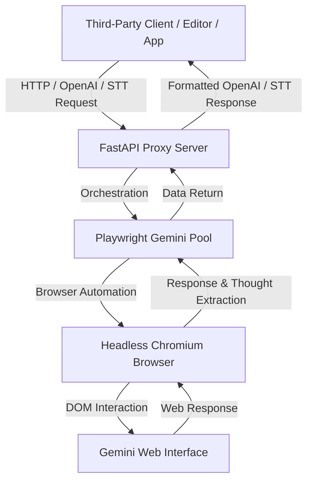

# Gemini-API-Wrapper

<p align="center">
    
</p>

Stop paying for AI tokens! Transform Google Gemini into a free API or extract the maximum from your Pro subscription without rate limit interruptions.

**Gemini-API-Wrapper** is a local proxy server (built with Python & Playwright) that seamlessly emulates the OpenAI API. It acts as a local gateway, allowing you to use Google Gemini's intelligence in your favorite development environments, third-party clients, or AI applications.

---

## ⚡ Superpowers Included

* **✅ OpenAI Standard**: Emulates standard OpenAI API endpoints (`/v1/chat/completions`) natively, allowing easy integration into any compatible third-party client or AI tool.
* **✅ Automatic Multi-Account Fallback**: Hit the Gemini Advanced rate limit? The proxy automatically switches to the next configured Google account in your pool instantly, keeping your applications running without interruption.
* **✅ Multimodal & Reasoning**: Native support for images, audio (Speech-to-Text transcribing), and Extended Thinking (thought extraction).
* **✅ Run Locally & Invisibly**: Everything runs on your machine. Completely open-source and background-based.

---

## 🔍 How It Works Under the Hood

The proxy acts as an intelligent intermediary. Instead of consuming official API tokens, it automates and interacts with the official web interface of Google Gemini in the same way a human would—except it does so programmatically, instantly, and in the background (headless browser mode).



### 1. Engine Architecture
* **FastAPI Web Server**: Exposes API endpoints mimicking standard providers.
* **Playwright Pool**: Manages optimized Chromium browser instances in the background.
* **Smart Selectors**: Programmatically inputs text, uploads media assets, triggers the submit function, and streams the output back in real-time.
* **Thinking & Thought Extraction**: Separately extracts both the raw textual response and the inner thoughts/reasoning process (Extended Thinking) from the interface.

### 2. Multi-Profile Session Pool
To prevent account rate-limiting and allow scaling, you can log in to multiple Google accounts. Each account is stored as an independent browser profile in the `profiles/` directory:
```text
profiles/
├── account_1/
│   └── cookies.json     # Authentication cookies
├── account_2/
│   └── cookies.json
└── cookies/
    └── cookies.json     # Default profile
```
If the active account encounters a rate limit or a temporary block, the proxy rotates to the next available profile in the pool, ensuring maximum availability.

---

## 🛠️ Step-by-Step Installation

Follow these instructions from scratch to clone, install, and run the project.

### 1. Clone the Repository
Open a terminal (Command Prompt, PowerShell, or Bash) and run:
```bash
git clone https://github.com/leonardoplanello/Gemini-API-Wrapper.git
cd Gemini-API-Wrapper
```

### 2. Configure Google Gemini Accounts
To authenticate, the local wrapper needs session cookies from your Google Gemini account. You can configure one or more accounts.

#### Method A: Automated Playwright Login (Recommended)
This is the easiest and most robust method. It opens an automated browser for you to log in, then extracts and manages the cookies automatically.

1. **On Windows (Automated Script)**:
   Run the automated setup batch script in the root directory:
   ```cmd
   setup_and_run.bat
   ```
   *This script automatically creates a virtual environment, installs dependencies, sets up Playwright, and starts the configuration wizard.*

2. **Manual Configuration (Any OS)**:
   If you prefer to configure manually or are on macOS/Linux:
   * Create and activate a Python virtual environment:
     ```bash
     python -m venv venv
     source venv/bin/activate  # On Windows: venv\Scripts\activate
     ```
   * Install the project and dependencies:
     ```bash
     pip install -e .
     pip install fastapi uvicorn playwright pillow
     python -m playwright install chromium
     ```
   * Initialize and log in to a profile (replace `<profile_name>` with your custom name, e.g., `personal_account`):
     ```bash
     python sync_cookies.py <profile_name> --login
     ```
     *A browser window will open. Log in to your Google account, navigate to Gemini, verify everything is loaded, and then close the browser window.* The cookies will be saved in `profiles/<profile_name>/cookies.json`.

#### Method B: Manual Cookie Export
1. Install a cookie exporter extension in your web browser.
2. Log in to [Google Gemini](https://gemini.google.com/).
3. Export cookies in **JSON** format.
4. Save the exported file under the project directory as `profiles/<profile_name>/cookies.json` (create the folders if they do not exist).

---

### 3. Select the Model & Active Profile
1. Choose which profile should be used by default:
   ```bash
   echo <profile_name> > .selected_profile
   ```
2. Interactively select your desired Gemini model (e.g. standard Gemini, Flash, or Flash Thinking with Extended Thinking):
   ```bash
   python select_model.py
   ```
   Follow the on-screen instructions to select your model. The selection is saved in `.selected_model`.

---

## 🚀 Running the Proxy Server

To start the server locally:
```bash
python proxy_server.py
```
The server will boot up and start listening on port `8000`: `http://localhost:8000`.

---

## 🔌 Third-Party Integration

Configure your preferred third-party AI editor, agent framework, or application with the following settings:

* **API Base URL / Endpoint**: `http://localhost:8000/v1beta/openai` (or `http://localhost:8000/v1beta/openai/chat/completions`)
* **API Key**: Any value (e.g., `sk-generic-key`)
* **Model**: Any name (the proxy automatically redirects all completions to your selected Gemini model)

### Example Request Structure
Your integrations will send standard payloads which are converted automatically by the proxy:

```bash
curl "http://localhost:8000/v1beta/openai/chat/completions" \
  -H "Authorization: Bearer sk-generic-key" \
  -H "Content-Type: application/json" \
  -d '{
    "model": "gemini-3.5-thinking",
    "messages": [
      {"role": "system", "content": "You are a helpful programming assistant."},
      {"role": "user", "content": "Explain quantum computing in one sentence."}
    ]
  }'
```

---

## 🎤 Speech-to-Text (STT) Integration

The proxy also exposes a Google Speech-to-Text compatible endpoint at `/v1/speech:recognize`. 

To integrate voice transcriptions in your compatible clients:
* **Audio Format**: Send audio in `LINEAR16` (PCM 16kHz) encoded as base64.
* **Behind the Scenes**: The proxy converts the incoming PCM to standard WAV format, uploads it directly to Gemini as a multimodal asset, and utilizes Gemini's multimodal capabilities to extract a highly accurate transcript.

---

## ⚖️ License

This project is licensed under the MIT License. See the [LICENSE](file:///E:/1CODE/Gemini%20API%20Wrapper/LICENSE) file for more information.

---

⭐ **If this project saved your pocket, consider giving it a star on GitHub!**
